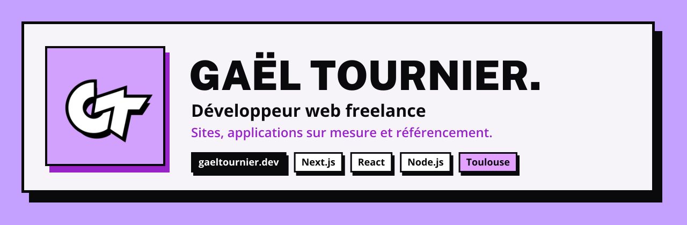
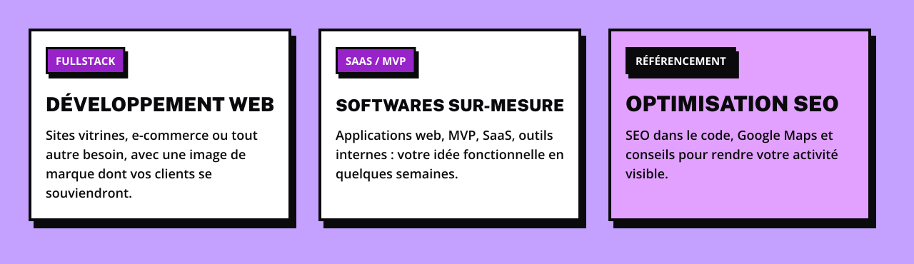

 

   

**[gaeltournier.dev](https://gaeltournier.dev)**

## Stack

| Domaine     | Outil                                    |
| ----------- | ---------------------------------------- |
| Framework   | Next.js 16 (App Router)                  |
| UI          | React 19, Tailwind CSS v4, Framer Motion |
| Icônes      | Lucide, React Icons                      |
| Hébergement | Vercel (Analytics, Speed Insights)       |

## Contact

Un projet de site ou d'application ? → **[gaeltournier.dev/contact](https://gaeltournier.dev/contact)**

---

© Gaël Tournier. Code partagé à titre de démonstration ; contenus, textes et visuels non réutilisables sans accord.
